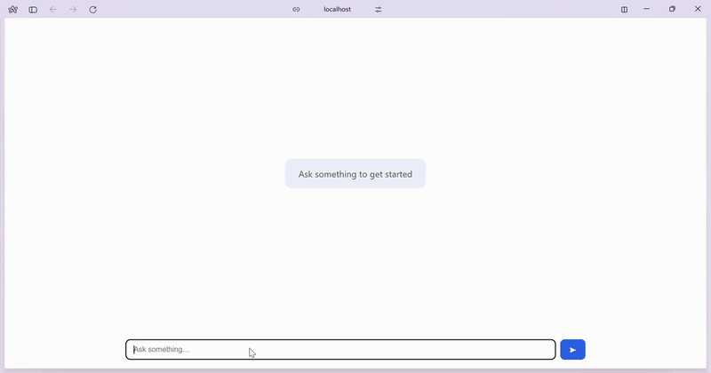
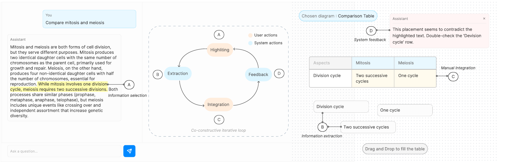
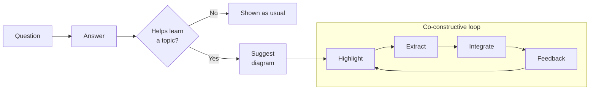
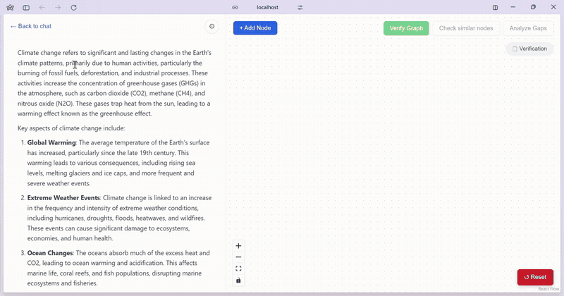
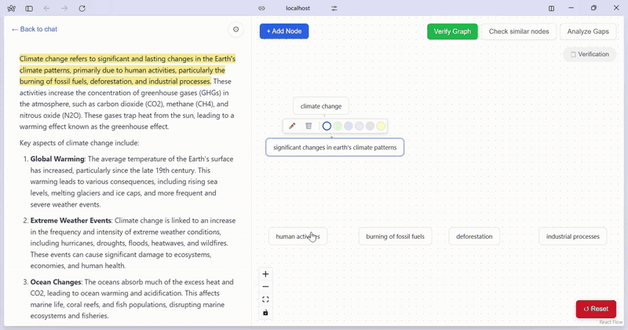
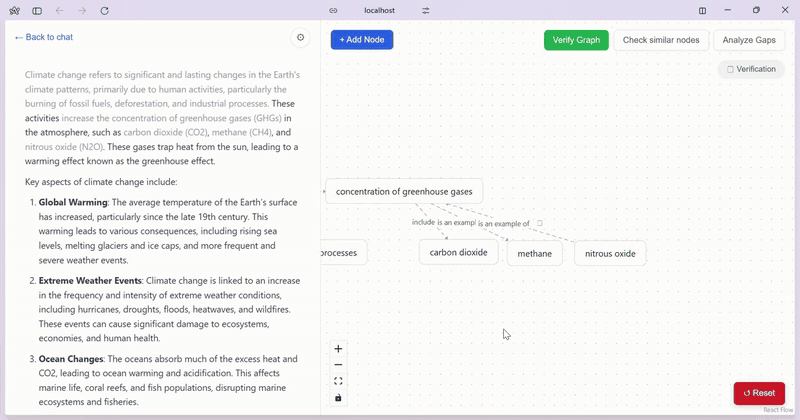
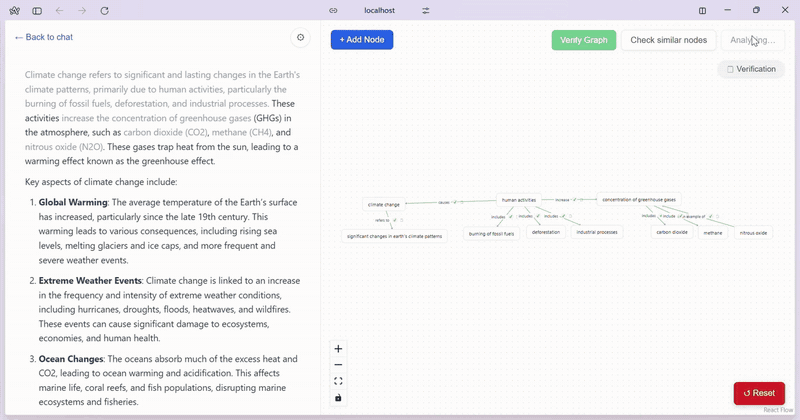
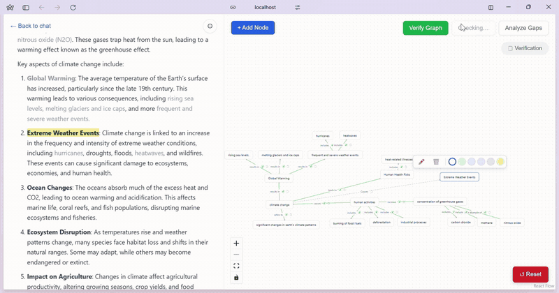
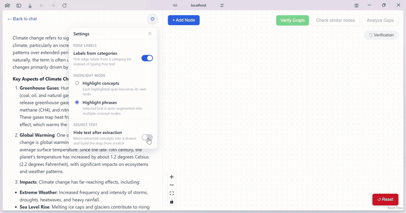
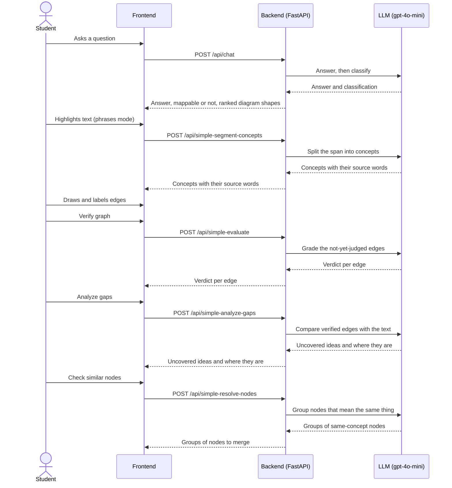

# Co-constructive Diagramming

A learning tool that turns an AI chatbot answer into a diagram the student has to **build themselves**. Instead of reading the answer and moving on, the student highlights the key ideas, assembles them into a diagram, and gets AI feedback on whether the result is actually supported by the text.

The AI never draws the diagram. It checks the student's work, points at what is missing without giving the answer away, and explains mistakes. The understanding is built by the student, with the AI as a reviewer: *co-constructive*.

## Contents

- [The problem](#the-problem)
- [The solution](#the-solution)
- [General workflow](#general-workflow)
- [Features and API](#features-and-api)
  - [Chat and diagram suggestion](#1-chat-and-diagram-suggestion)
  - [Concept maps](#a-concept-maps)
  - [Other diagrams (planned)](#b-other-diagrams-planned)
- [Tech stack](#tech-stack)
- [Project structure](#project-structure)
- [Getting started](#getting-started)
  - [Troubleshooting](#troubleshooting)
  - [Configuration](#configuration)
- [Next features](#next-features)

## The problem

Chatbot answers are verbose and fluent, which make them prone to be read passively, inducing illustion of understanding where readers come away feeling they understood, without having processed or retained much.

## The solution

Make the student rebuild the answer instead of reading it.

Every chatbot answer is first analyzed. If it is an explanation the user is likely using to learn a topic (not a quick fact or task instructions), the system suggests the diagram that best fits the content and invites the user to rebuild the answer as that diagram, rather than just read it.



The rebuilding follows a short loop:



1. **Highlight** a span of the answer.
2. **Extract:** the system turns it into a small visual unit (for example a node).
3. **Integrate:** the student places and connects the units into the diagram.
4. **Feedback:** the system checks the result against the text and flags what does not hold up.

The loop is the same for every diagram type; what changes is the unit (a node, a table cell, a step) and what feedback checks. Today the tool supports [concept maps](#a-concept-maps). Other diagrams are listed under [planned diagrams](#b-other-diagrams-planned).

## General workflow

The same flow applies to every diagram type:



## Features and API

### 1. Chat and diagram suggestion

Shared by every diagram type. After each answer, a classifier decides whether the answer is worth turning into a diagram (an explanation of a subject, rather than instructions for a task) and, if so, offers to open it. It ranks the diagram shapes that fit, so new diagram types plug in here.

| Endpoint | Agent | What it does |
|---|---|---|
| `POST /api/chat` | chat + `classifier` | Answers the question, then classifies whether the answer is mappable: a free length check first, then one LLM call that rejects task content (recipes, install guides…) and ranks the diagram shapes that fit |

### 2. Diagram co-construction

Once the student accepts a suggested diagram, they rebuild the answer through the highlight, extract, integrate and feedback loop. Each diagram type defines its own visual unit, feedback checks and endpoints.

#### a. Concept maps

**Status:** supported. Concept maps are the most general structure for explanatory text: concepts are nodes and labelled relations are edges, which is enough to express causes, hierarchies, part-whole structure and comparisons.

##### Features

- **Extract concepts by highlighting.** Highlighting a phrase creates a node, either the exact selection or, in *phrases* mode, the selection split into separate concepts by an LLM. Text already used is greyed out.



- **Connect concepts.** The student draws arrows between nodes and labels them by typing, by highlighting text, or by picking from relation categories such as *Cause & Effect* or *Part of*.



- **Verify graph.** Every connection is graded against the text. Correct edges turn green; the others get a hint and, when the text supports one, a suggested correction. The student can override an incorrect verdict  with *Confirm as correct*.



- **Analyze gaps.** Names the parts of the text the verified map does not cover yet, and where to find them, without saying what to draw.



- **Check similar nodes.** Suggests concepts that are the same idea under different names (e.g. *GenAI* and *Generative AI*), which can then be merged.



- **Hide text after extraction (optional mode).** After reading the initial text, its main concepts are extracted and the text is hidden. The student then rebuilds it as a concept map without looking at the original text.



##### API

| Endpoint | Agent | What it does |
|---|---|---|
| `POST /api/simple-segment-concepts` | `simple_segmenter` | Splits a highlighted span into node-ready concepts, each with the exact words it came from so the frontend can highlight them |
| `POST /api/simple-evaluate` | `simple_evaluator` | Grades every not-yet-judged edge against the text in one call, with a verbatim supporting quote, a justification and an optional correction |
| `POST /api/simple-analyze-gaps` | `simple_gap_analyzer` | Compares the **verified** edges with the text and names up to five uncovered ideas and where they are |
| `POST /api/simple-resolve-nodes` | `node_resolver` | Groups node labels that refer to the same concept |

How the endpoints are called during a session:




All agents return structured output (Pydantic models) with reasoning fields generated before the decision fields, so the model gathers evidence before it commits to a verdict. 
#### b. Other diagrams (planned)

The classifier already ranks these shapes, but none can be built yet. Each would add its own extraction unit, feedback agent and endpoints, documented in a section like the one above.

- **Comparison table** for contrasting items across aspects.
- **Flowchart** for procedures and decisions.
- **Sequence / timeline** for ordered events.

## Tech stack

| | |
|---|---|
| **Frontend** | React 19, TypeScript, Vite, [React Flow](https://reactflow.dev) (`@xyflow/react`), CSS Custom Highlight API |
| **Backend** | Python, FastAPI, Pydantic v2, LangChain (`langchain-openai`), OpenAI `gpt-4o-mini` |

## Project structure

```
backend/
  app/
    main.py              # FastAPI app: CORS, startup checks, router
    config.py            # model name, timeout and retries, from the environment
    api/                 # endpoints and central error handling
    agents/              # one module per LLM task
    prompts/             # system prompts, one per agent
    schemas/             # API payloads and LLM output models (Pydantic)
    utils/               # graph payload helpers, timing logs
frontend/
  src/
    App.tsx              # shared state: source text, highlights, edges
    api.ts               # typed client for the backend
    components/          # SourcePanel (chat + text), Canvas (map), nodes, edges, dialogs
    hooks/               # useRequest, useCssHighlight
    utils/               # graph helpers, text offsets, Markdown rendering
```

## Getting started

You will run two programs side by side, each in its own terminal: the **backend** (Python API) and the **frontend** (web interface).

### Prerequisites

- **Python 3.14** (the version used in development), installed directly or through [Miniconda/Anaconda](https://docs.anaconda.com/miniconda/)
- **Node.js 24** and npm ([nodejs.org](https://nodejs.org))
- An **OpenAI API key** ([platform.openai.com](https://platform.openai.com/api-keys))

Clone the repository:

```bash
git clone https://github.com/lynn1404/Co-constructive-interfaces.git
cd Co-constructive-interfaces
```

### 1. Backend

All commands in this section run from the `backend/` folder:

```bash
cd backend
```

#### 1.1 Create and activate a Python environment

Pick **one** option, conda or venv.

**Option A: conda** (same commands on every OS)

```bash
conda create -n co-constructive python=3.14
conda activate co-constructive
```

**Option B: venv** (built into Python)

Create the environment:

| OS | Command |
|---|---|
| Windows | `python -m venv .venv` |
| macOS / Linux | `python3 -m venv .venv` |

Activate it:

| OS / shell | Command |
|---|---|
| Windows (PowerShell) | `.venv\Scripts\Activate.ps1` |
| Windows (Command Prompt) | `.venv\Scripts\activate.bat` |
| macOS / Linux | `source .venv/bin/activate` |

Once it is active, the environment name, `(co-constructive)` or `(.venv)`, appears at the start of your prompt.

#### 1.2 Install the dependencies

```bash
pip install -r requirements.txt
```

#### 1.3 Add your OpenAI key

Copy the example settings file:

| OS / shell | Command |
|---|---|
| Windows (PowerShell) | `Copy-Item .env.example .env` |
| Windows (Command Prompt) | `copy .env.example .env` |
| macOS / Linux | `cp .env.example .env` |

Open `backend/.env` and replace the placeholder with your key:

```
OPENAI_API_KEY=sk-...
```

`.env` is ignored by git, so your key is never committed.

#### 1.4 Start the API

```bash
uvicorn app.main:app --reload
```

Check it is running: http://localhost:8000 returns `{"status": "ok", ...}`, and http://localhost:8000/docs shows the interactive API documentation.

Keep this terminal open. Next time, you only need to activate the environment (step 1.1) and start the API (step 1.4).

### 2. Frontend

In a **second terminal**, from the repository root:

```bash
cd frontend
npm install
npm run dev
```

Open http://localhost:5173. The frontend talks to the backend at `http://localhost:8000/api` by default, so no configuration is needed.

Next time, `npm run dev` is enough.

### Troubleshooting

| Symptom | Likely cause |
|---|---|
| "Could not reach the server" or "Couldn't reach the assistant" | The backend is not running, or `VITE_API_BASE` in `frontend/.env` points to the wrong address |
| "The AI service is not configured correctly" | `OPENAI_API_KEY` is missing or invalid in `backend/.env`; restart the backend after fixing it |
| `ModuleNotFoundError` when starting the backend | The Python environment is not activated in that terminal (step 1.1) |
| Port 8000 or 5173 already in use | Another copy is still running; stop it, or run `uvicorn app.main:app --reload --port 8001` and set `VITE_API_BASE=http://localhost:8001/api` in `frontend/.env` |

### Configuration

All settings are optional except the API key.

| Variable | Where | Default | Purpose |
|---|---|---|---|
| `OPENAI_API_KEY` | `backend/.env` | (required) | OpenAI access |
| `LLM_MODEL` | `backend/.env` | `gpt-4o-mini` | Model used by every agent |
| `LLM_TIMEOUT_S` | `backend/.env` | `120` | Per-request timeout, in seconds |
| `ALLOWED_ORIGINS` | `backend/.env` | `http://localhost:5173,http://127.0.0.1:5173` | CORS origins, comma-separated |
| `VITE_API_BASE` | `frontend/.env` | `http://localhost:8000/api` | Backend URL used by the frontend |

Restart the backend or the frontend after changing its `.env` file; settings are only read at startup.

## Next features

- **Saving and loading maps**, with per-student history. Maps currently live in the browser and are lost on refresh.
- **More diagram types:** comparison tables, flowcharts and sequence/timelines (see [other diagrams](#b-other-diagrams-planned)).
